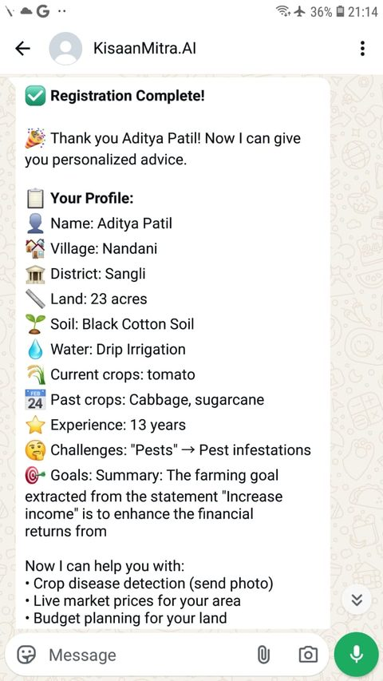
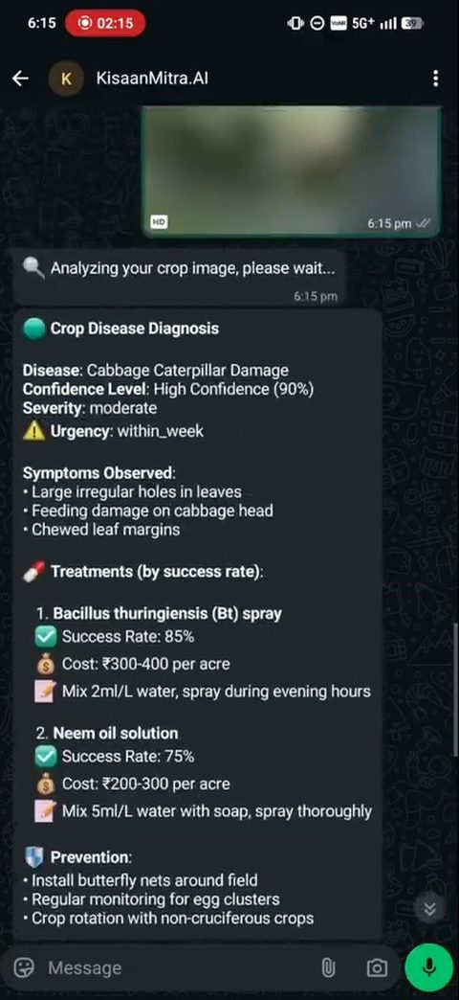
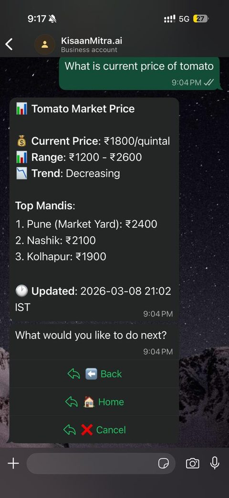
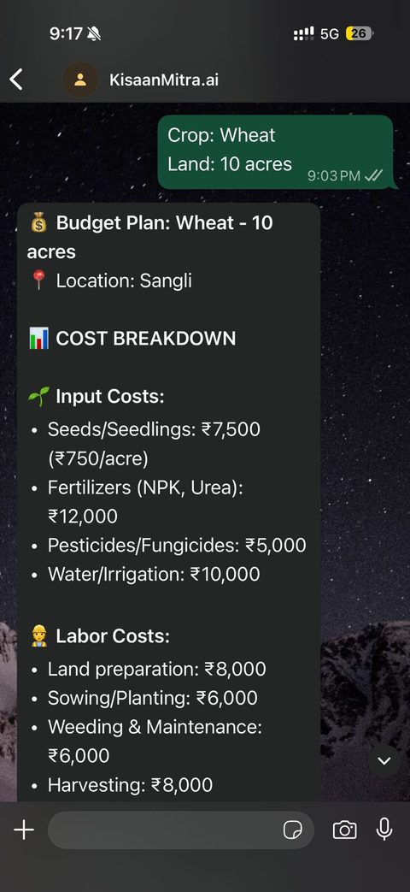
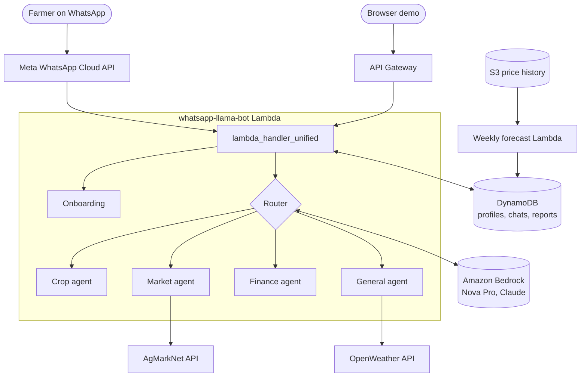

<p align="center">
  
</p>

<h1 align="center">KisaanMitra.AI</h1>

<p align="center">
  A WhatsApp assistant for farmers in Maharashtra, in Hindi and English.<br>
  Built for the AWS AI for Bharat hackathon (Feb - Mar 2026).
</p>

<p align="center">
  
  
  
  
  
</p>

<p align="center">
  <a href="https://youtu.be/HGGA7kz9L8U"><b>Demo video</b></a> &nbsp;|&nbsp;
  <a href="docs/KisaanMitra_AI_Submission.pdf"><b>Submission deck (PDF)</b></a> &nbsp;|&nbsp;
  <a href="docs/KisaanMitra_AI_Submission.pptx"><b>PPTX</b></a>
</p>

---

A farmer sends a text or a photo of a leaf and the bot answers about crop disease, mandi prices, price forecasts, crop budgets, government schemes and the weather. A short onboarding chat stores each farmer's village, land and crops. Every answer uses that profile. When a farmer reports a disease, the other farmers in the same village who grow that crop get a WhatsApp alert.

## Screenshots

<table>
  <tr>
    <td align="center"></td>
    <td align="center"></td>
    <td align="center"></td>
    <td align="center"></td>
  </tr>
  <tr>
    <td align="center"><b>Onboarding</b><br>profile saved after a short chat</td>
    <td align="center"><b>Crop agent</b><br>disease diagnosis from a photo</td>
    <td align="center"><b>Market agent</b><br>mandi prices with back / home / cancel</td>
    <td align="center"><b>Finance agent</b><br>crop budget for the farmer's land</td>
  </tr>
</table>

## What it does

| | Feature | Details |
|---|---|---|
| 1 | **Onboarding** | Asks name, village, district, land size, soil, water source, current and past crops, years of farming, problems and goals. Saved in DynamoDB. |
| 2 | **Crop agent** | Diagnoses disease from a leaf photo and answers crop questions with the local weather added. Reports are stored by village so neighbours get alerts. |
| 3 | **Market agent** | Today's mandi prices from the AgMarkNet API (data.gov.in). If AgMarkNet has nothing, the model estimates the price and the reply says so. |
| 4 | **Price forecast** | Next-day and 7-day forecasts for onion, rice, sugarcane, tomato and wheat, from five years of Maharashtra modal prices. |
| 5 | **Finance agent** | Budget for a crop and land size (input costs, yield, profit), loan options and matching schemes such as PM-KISAN. |
| 6 | **General agent** | Weather from OpenWeather, "who else grows sugarcane in my village" questions and anything that fits nowhere else. |
| 7 | **Navigation** | WhatsApp list menus and buttons with `back`, `home` and `cancel`. |
| 8 | **Web demo** | `demo/web-chat-demo.html` talks to the same Lambda, so the bot can be tried without WhatsApp. |
| 9 | **Dashboards** | D3.js knowledge graph of farmers, villages and crops (`demo/`) and a Streamlit dashboard (`dashboard/`). |

## AI models used

The replies on WhatsApp are written by large language models. The code adds the farmer's profile, weather, prices and past messages to the prompt and formats the answer.

| Model | Where | Used for |
|---|---|---|
| Amazon Nova Pro (Bedrock) | `services/ai_service.py`, `onboarding/` | picking the agent, answers of all four agents, pulling crop and place names out of messages, reading onboarding answers |
| Claude 3.5 Sonnet (Bedrock) | `enhanced_disease_detection.py` | disease diagnosis from a leaf photo |
| Claude 3 Sonnet (Bedrock) | `price_forecasting.py` | price outlook when no stored forecast exists |
| Claude Sonnet (Anthropic API) | `anthropic_client.py`, `market_data_sources.py` | price estimate when AgMarkNet has no data |

The weekly price forecast itself is plain statistics (last 90 day average plus trend), not a model.

## Architecture



1. Meta sends the WhatsApp message to the webhook of the `whatsapp-llama-bot` Lambda.
2. `lambda_handler_unified.py` passes WhatsApp webhooks to `lambda_handler_v2.py` and web demo requests to `lambda_handler_web.py`.
3. The handler loads the farmer's profile and recent messages from DynamoDB. New users go through onboarding first.
4. Photos go to disease detection. Text is routed to the crop, market, finance or general agent.
5. The agent calls Bedrock, AgMarkNet, OpenWeather or DynamoDB and the reply goes back through the WhatsApp Cloud API.

## Project layout

```
src/lambda/                 main bot Lambda
  lambda_handler_unified.py   entry point
  lambda_handler_v2.py        WhatsApp handler
  lambda_handler_web.py       web demo handler
  agents/                     crop, market, finance and general agents
  services/                   Bedrock calls, conversation memory, cache, language, WhatsApp API
  forecast_reply.py           reads stored forecasts for the bot
  lambda_sagemaker_forecaster.py  weekly forecast job
  lambda_kg_updater.py        rebuilds the knowledge graph JSON in S3
  deploy.sh                   packages and deploys the bot
src/onboarding/             onboarding chat and farmer profiles
src/hyperlocal/             village disease reports, treatments and alerts
src/sagemaker_forecasting/  optional SageMaker AutoML training and batch transform
data/historical_prices/     AgMarkNet modal prices, Maharashtra, Mar 2021 - Mar 2026
infrastructure/             scripts for the DynamoDB tables, API Gateway, IAM and schedules
demo/                       web chat demo, knowledge graph dashboard, data generators
dashboard/                  Streamlit dashboard
docs/                       hackathon submission deck (PDF and PPTX)
docs/images/                screenshots used in this README
scripts/                    user admin, demo and test scripts that call the deployed Lambda
tests/                      scenario tests against the deployed Lambda
```

## Setup

You need an AWS account with the AWS CLI configured, Bedrock model access in `us-east-1` for Amazon Nova Pro and Claude 3.5 Sonnet and a WhatsApp Business app in the Meta developer console. Everything else runs in `ap-south-1`.

1. Create the tables:

   ```bash
   cd infrastructure
   ./setup_dynamodb.sh
   ./setup_onboarding_tables.sh
   ./setup_hyperlocal_tables.sh
   ./setup_finance_tables.sh
   ./setup_state_table.sh
   ./setup_navigation_table.sh
   ```

2. Create a Python Lambda named `whatsapp-llama-bot`. `update_iam_permissions.sh` gives its role DynamoDB, S3 and Bedrock access and `update_lambda_config.sh` sets a 60 s timeout and 512 MB memory.

3. Set the environment variables listed in `.env.example` on the Lambda.

4. Deploy the code:

   ```bash
   cd src/lambda
   ./deploy.sh
   ```

5. Expose the Lambda over HTTPS (API Gateway or a function URL) and set that URL as the WhatsApp webhook with your `VERIFY_TOKEN`. For the web demo, `infrastructure/setup_api_gateway.sh` creates a `/chat` endpoint; put it in `API_ENDPOINT` in `demo/web-chat-demo.html`.

6. Price forecasts: `infrastructure/setup_sagemaker_forecasting.sh` (run from the repo root) uploads the CSVs, creates the forecast Lambda and schedules it every Sunday. Invoke it once by hand to fill the table. `FORECAST_METHOD=automl` on that Lambda starts a SageMaker AutoML training job instead and `FORECAST_METHOD=batch` uses the trained model, which needs a pandas layer and batch transform quota.

7. Knowledge graph: `python demo/generate_10k_farmers.py` creates `demo/knowledge_graph_dummy_data.json` (about 5 MB, not tracked). Upload it to the `kisaanmitra-knowledge-graph` bucket and deploy the updater with `src/lambda/deploy_kg_updater.sh`, which merges real farmer profiles into it.

8. Dashboard:

   ```bash
   pip install -r dashboard/requirements.txt
   cd dashboard
   ./run_dashboard.sh
   ```
